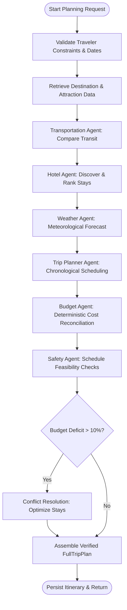

# TRIPORA.AI — Agentic AI Travel Planner
### Multi-Agent Intelligent Trip Planning and Real-Time Travel Assistant

> **Tagline:** *Your Journey. Intelligently Orchestrated.*  
> **Academic Foundation:** Multi-Agent Collaborative Decision-Making Travel Platform.

---

## 🧭 Overview & Core Objectives

**TRIPORA.AI** is a professional-grade agentic AI travel planning web application built on a collaborative swarm of six specialized autonomous agents orchestrated via **LangGraph 1.2+**. Rather than relying on a single conversational prompt or unverified LLM hallucinations, TRIPORA coordinates domain-specific agents over typed state graphs, enforces deterministic mathematical financial budgeting in **INR**, tracks live meteorological forecasts from **Open-Meteo**, and supports automatic itinerary replanning with visual diff comparisons.

### Core Deliverables Achieved:
1. **Intelligent Travel Planning:** Personalized day-by-day scheduling with morning, afternoon, and evening slots.
2. **Collaborative Multi-Agent Architecture:** Six distinct agents with typed inputs/outputs connected through LangGraph.
3. **Deterministic Financial Budgeting:** Category expense reconciliation and a strict 5% contingency reserve in INR.
4. **Multi-Modal Transit Comparison:** Flights, express railway, sleeper coach, and private outstation cab options with travel time and fare brackets.
5. **Accommodation Discovery:** Verified hotels and boutique stays ranked by distance to sights and budget fit.
6. **Weather Intelligence & Rain Self-Healing:** Automatic detection of precipitation with seamless indoor museum substitutions.
7. **Context-Grounded AI Concierge:** Chatbot grounded strictly in active trip state with zero fabricated bookings.
8. **Automatic Itinerary Replanning:** Dynamic recomputation with previous vs revised cost diff views.
9. **Safety & Reliability Engine:** Detection of schedule over-saturation and authoritative advisory notices.

---

## 🤖 The Six Specialized AI Agents

| Agent Name | Module | Primary Responsibility | Data Source |
| :--- | :--- | :--- | :--- |
| **Trip Planner Agent** | `app/agents/planner_agent.py` | Chronological sequencing, geographical grouping, and duration estimation | Verified POI Catalog / OpenStreetMap |
| **Budget Optimization Agent** | `app/agents/budget_agent.py` | Exact mathematical category accounting, deficit detection, and cost saving advice | Deterministic Python Financial Engine (INR) |
| **Transportation Agent** | `app/agents/transport_agent.py` | Multimodal transit comparisons, haversine distances, and journey durations | Regional Transit Benchmarks & OSRM |
| **Hotel & Lodging Agent** | `app/agents/hotel_agent.py` | Property discovery, room count arithmetic, proximity rankings, and amenity checks | Verified Accommodation Knowledge Base |
| **Weather Intelligence Agent** | `app/agents/weather_agent.py` | Multi-day meteorological risk evaluation and indoor attraction substitutions | Open-Meteo Global Satellite API |
| **Safety & Reliability Agent** | `app/agents/safety_agent.py` | Schedule pacing checks, data freshness verification, and consular advisories | Official Advisory Baseline & Spatial Checks |

---

## 🔄 LangGraph Multi-Agent Orchestration Flow



---

## 🛠️ Technology Stack

- **Frontend:** React 19, TypeScript, Vite, Tailwind CSS v4, React Router, Recharts, Leaflet (OpenStreetMap), Lucide Icons.
- **Backend:** Python 3.14, FastAPI, Pydantic V2, SQLAlchemy, SQLite (Dev) / PostgreSQL (Prod), Uvicorn.
- **Multi-Agent Engine:** LangGraph 1.2+, LangChain Core, StateGraph with conditional transitions.
- **Testing:** Pytest & HTTPX (Backend), Vitest & React Testing Library (Frontend).

---

## 🚀 Quick Start Guide

### 1. Prerequisites
- Python 3.10+ (tested on Python 3.14.0)
- Node.js 18+ (tested on v24.11.0 / npm 11.6+)

### 2. Backend Setup & Startup

```bash
cd backend

# 1. Activate the pre-configured virtual environment
# On Windows (PowerShell):
.\.venv\Scripts\Activate.ps1
# On Linux/macOS:
# source .venv/bin/activate

# 2. Run the automated Pytest suite (7 test suites)
pytest -v

# 3. Start the FastAPI server on port 8000
python main.py
```
> The API will be live at: **http://127.0.0.1:8000**  
> Interactive Swagger API Documentation: **http://127.0.0.1:8000/docs**

### 3. Frontend Setup & Startup

```bash
cd frontend

# 1. Run the Vitest component test suite
npm run test

# 2. Test the production build
npm run build

# 3. Launch the Vite development server
npm run dev
```
> The web application will be accessible at: **http://localhost:5173**

---

## 🔑 Pre-Seeded Demo Account

For rapid evaluation and testing without registering, use the pre-seeded account:
- **Email:** `demo@tripora.ai`
- **Password:** `tripora123`
*(Or click the **"Quick Demo Login"** button on the Navbar or Login page for instant one-click access).*

---

## 🧪 Automated Test Results Summary

- **Backend Pytest Suite:** `7 passed in 8.39s`
  - `test_api_health` (PASSED)
  - `test_auth_and_trip_crud` (PASSED)
  - `test_budget_reconciliation` (PASSED — verifies mathematical category sums)
  - `test_over_budget_detection` (PASSED — verifies deficit triggers and recommendations)
  - `test_planner_creates_requested_days` (PASSED)
  - `test_planner_rain_adaptation` (PASSED — verifies indoor substitutions during rain)
  - `test_langgraph_full_trip_workflow` (PASSED — verifies end-to-end multi-agent graph)
- **Frontend Vitest Suite:** `3 passed in 341ms`
  - `ItineraryView` renders chronological stops and time tags (PASSED)
  - `BudgetChart` renders budget surplus/deficit and category percentages (PASSED)
  - `AgentStatusTracker` renders agent telemetry and status badges (PASSED)
- **Production Build:** `tsc -b && vite build` completed cleanly in 1.94s with 0 errors.

---

## 🔒 Security, Privacy & Integrity Standards

- **Server-Side Secret Isolation:** API keys and credentials are stored strictly in backend `.env`.
- **JWT Cryptography:** Signed authentication tokens with bcrypt password hashing.
- **Resource Ownership Enforcement:** All trip access and chat queries strictly enforce `user_id == current_user.id`.
- **Zero Fabricated Bookings:** The platform explicitly discloses demo data vs verified provider links, with honest disclaimers that bookings require external confirmed payment integrations.
